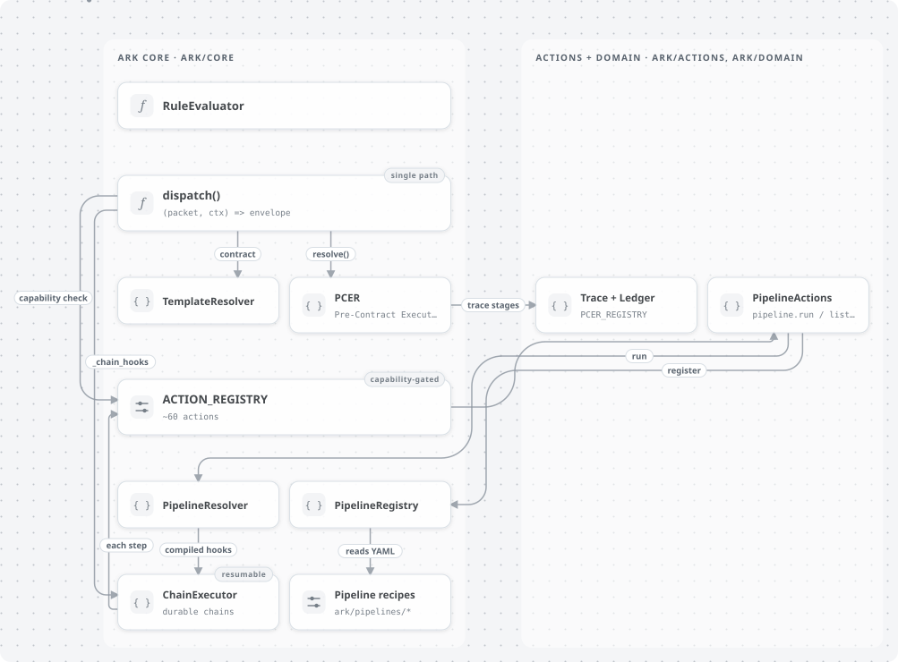
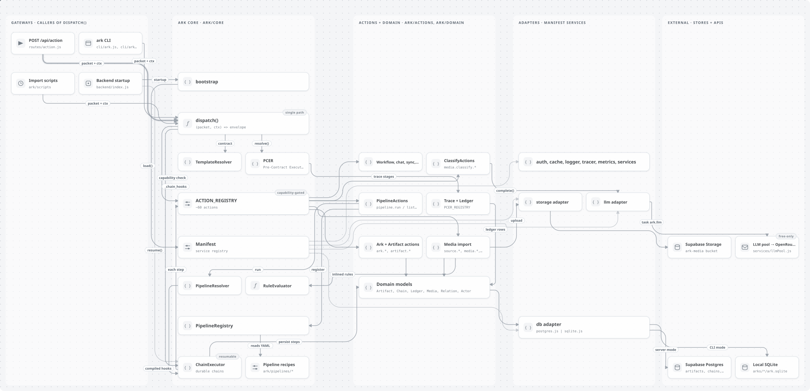

# ARK

> ARK is a memory operating system in which immutable intent is resolved
> through contracts into governed execution, producing durable artifacts,
> provenance, and memory.




The full architecture reference is **[CHARTER.md](./CHARTER.md)** —
read it before changing runtime primitives. What follows is a short
orientation, not a replacement for it.

## Principles

A handful of constitutional rules shape everything else:

- **Everything is an Artifact.** Durable units of content/state/reference
  are the one substrate — notes, photos, templates, pipelines, even
  Arks themselves.
- **Everything meaningful is governed by Contracts.** Intent resolves
  into execution through declared rules, not ad hoc code paths.
- **There are no privileged execution paths.** The CLI, the HTTP gateway,
  and internal scripts all call the same `dispatch()` — none of them
  reach the database directly.
- **Capabilities are declared before execution, never assumed.** A
  provider being *able* to run is not the same as being *authorized* to.
- **History is durable; authority is not.** What happened is preserved
  even after the permission that allowed it expires.
- **Execution must preserve provenance.** Every artifact can answer what
  produced it, from what source, through which contract.
- **Everything composes.** Prefer combining existing primitives
  (Artifact + Contract + Pipeline + Gateway + Resolver + Ledger) over
  inventing a new special-case engine for the next product idea.

See CHARTER.md §1 for the complete list, and §9 for the anti-patterns
these rule out in practice (privileged import paths, opaque executable
orchestration, permission flags multiplying per feature, product nouns
becoming engine primitives).

## The primitives

| Term | Meaning |
|---|---|
| **Artifact** | Durable unit of content/state/reference |
| **Contract** | Declared rules governing intent, access, execution, or relationship |
| **Packet** | Immutable statement of requested intent |
| **Manifest** | Host configuration — which adapters, services, and providers this vessel has |
| **Pipeline** | Ordered, composable declaration of stages |
| **Provider** | An implementation that satisfies a declared capability |
| **Executor** | How an executable provider's code actually runs (python, node, container, ...) |
| **Gateway** | A governed boundary through which ARK is reached — HTTP, CLI, USB, peer, etc. |
| **Chain** | Durable record of an ordered execution instance |
| **Ledger** | Proof of authorized execution and resolution |

`dispatch(packet, ctx)` is the single governed entry point underneath all
of them — every Gateway is a thin caller of the same function.

## Setup

```bash
npm install
cp .env.example .env   # fill in SUPABASE_URL/SUPABASE_KEY if you need
                        # anything beyond the local SQLite CLI vessel
node --test tests/unit.test.js
```

## Running it

The CLI (`cli/ark.js`) is the zero-network entry point — local SQLite
vessel by default, no Supabase project required:

```bash
node cli/ark.js dispatch artifact.create --payload '{"artifact_type":"note","title":"hello"}'
node cli/ark.js ls note
node cli/ark.js status
```

Everything else (storage, auth, llm, sync) is adapter configuration via
`Manifest` (see `core/bootstrap.js`). A host app boots ARK by injecting
its own clients:

```js
const { bootstrap } = require('./core/bootstrap');
const { supabase } = require('./services/supabase');

await bootstrap({
  db:      { client: supabase },
  storage: { client: supabase, bucket: 'ark-media' },
});
```

## Origin

This code was extracted from `seravanna-site/backend/ark/` — Seravanna
was always meant to be one tenant/vessel of this engine, not the engine
itself. `services/supabase.js` is the one piece that moved with it (the
external dependency a handful of files reached outside `ark/` for);
everything else is unchanged. See CHARTER.md for what's actually
built versus proposed in the current design.
