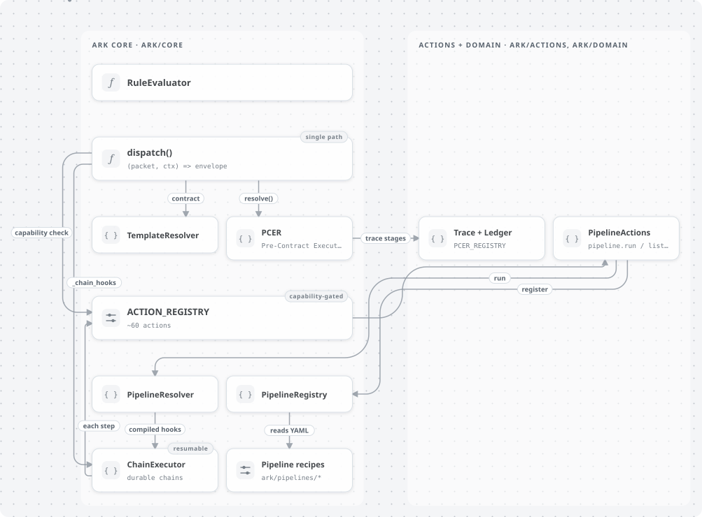
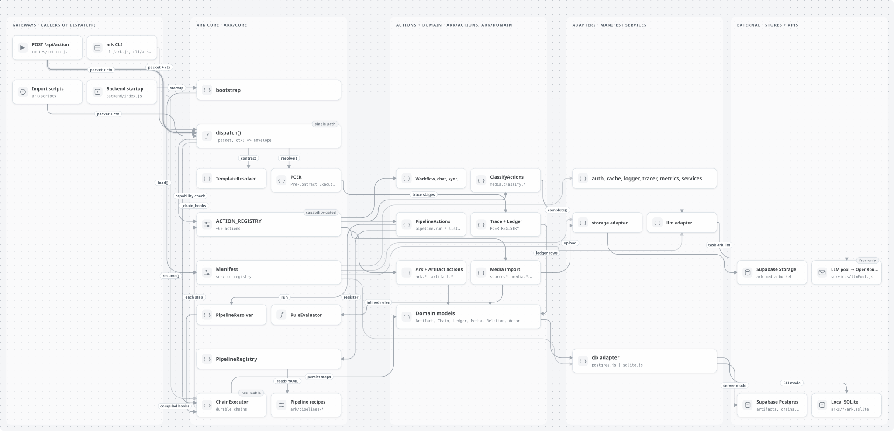

# ARK

> ARK is a memory operating system in which immutable intent is resolved
> through contracts into governed execution, producing durable artifacts,
> provenance, and memory.
<table>
<tr>
<td width="40%" valign="top">

</td>
<td valign="top">
<br>
<p>ARK is a portable, contract-driven memory and execution engine for applications, tools, and autonomous workflows.</p>

<p>Instead of building separate systems for storing information, executing workflows, tracking decisions, and preserving history, ARK composes those capabilities from a small set of reusable primitives.</p>

<p>Applications can integrate ARK through a governed dispatch interface while retaining control over their own architecture.</p>

<p>ARK preserves not only what happened, but what was requested, how it was resolved, and why the result exists.</p>
</td>
</tr>
</table>

### ARK Core


### Architecture Overview


## Governing documents

- **[CONSTITUTION.md](./CONSTITUTION.md)**: the articles governing ARK
  development. Its 23 articles are stable principles that every
  implementation must preserve, whatever the language, storage engine or
  API. Read it before proposing a design.
- **[CHARTER.md](./CHARTER.md)**: the architecture reference. It says
  what is built and what is only proposed, and it maps primitives to
  files. Read it before changing runtime primitives.

This README is a short orientation and replaces neither.

## Principles

A handful of constitutional rules shape everything else:

- **Everything is an Artifact.** Durable units of content/state/reference
  are the one substrate — notes, photos, templates, pipelines, even
  Arks themselves.
- **Everything meaningful is governed by Contracts.** Intent resolves
  into execution through declared rules, not ad hoc code paths.
- **There are no privileged execution paths.** TAll governed operations enter through
  the same dispatch() lifecycle, regardless of whether they originate from the CLI, HTTP gateway, or internal automation.
- **Capabilities are declared before execution, never assumed.** A
  provider being *able* to run is not the same as being *authorized* to.
- **History is durable; authority is not.** What happened is preserved
  even after the permission that allowed it expires.
- **Preserve first, understand second.** Raw preservation never depends
  on an LLM, classifier, or EXIF parse succeeding.
- **Execution must preserve provenance.** Every artifact can answer what
  produced it, from what source, through which contract.
- **Everything composes.** Prefer combining existing primitives
  (Artifact + Contract + Pipeline + Gateway + Resolver + Ledger) over
  inventing a new special-case engine for the next product idea.

See CHARTER.md for the complete architectural principles and CONSTITUTION.md for the governing invariants every implementation must preserve.

## The primitives

| Term | Meaning |
|---|---|
| **Artifact** | Durable unit of content/state/reference |
| **Contract** | Declared rules governing intent, access, execution, or relationship |
| **Packet** | Immutable statement of requested intent |
| **Manifest** | Host configuration — which adapters, services, and providers this vessel has |
| **MemChart** | What a vessel intends to remember |
| **Pipeline** | Ordered, composable declaration of stages, registered as an artifact |
| **Gateway** | A governed boundary through which ARK is reached — HTTP, CLI, USB, peer, etc. |
| **Chain** | Durable record of an ordered execution instance |
| **Ledger** | Proof of authorized execution and resolution |
| **Persona / Role** | What kind of vessel this is / what an actor may do on it (rank-based) |

`dispatch(packet, ctx)` is the single governed entry point underneath all
of them. Every packet runs the same PCER trace before its handler:

```text
trace.open → auth.verify → ledger.open → scope.resolve → payload.project → service.bind
```

Provider resolution, Executor, Promise, and Audience are **proposed, not
built** — see CHARTER.md §4.

## Setup

Requires Node 18.

```bash
npm install
cp .env.example .env
npm test
```

No env vars are needed for the tests or the local CLI — the default
vessel is SQLite. `SUPABASE_URL` / `SUPABASE_KEY` are only read when
something actually talks to the cloud: `ark publish` (`sync.push`),
`cli/ark-dev.js`, and `scripts/`. `OPENROUTER_*` is only needed for
LLM-backed stages (`pipelines/classify`). See `.env.example` for the rest.

## CLI

`cli/ark.js` (`ark` when linked via `npm link`) is a Gateway like any
other: every command builds a packet and calls `dispatch()`.

```bash
ark dispatch <action> [--payload '<json>']   # any ACTION_REGISTRY action
ark ls [artifact_type]                       # artifact.list
ark show <artifact_id>                       # artifact.get
ark arks                                     # graph-level ark containers
ark ledger [--limit n]                       # ledger.list
ark status                                   # vessel / owner / pipelines / media summary

ark rescan [slug]                            # register pipelines/* by content hash
ark pipeline [slug] --path <dir>             # run a pipeline (prompts if omitted)
ark cache <pipeline_slug> <bucket>           # materialize a cache bucket for review
ark publish <pipeline_slug> <bucket> [--dry-run]   # cache bucket → local Ark → Supabase
ark fork <name> <new-name>                   # copy a local instance, version bumped

ark seed-projects                            # project-base + developer template (idempotent, upgrades)
ark serve [--port n] [--read-only]           # Mission Control on 127.0.0.1 — token-gated
```

`ark serve` prints `http://127.0.0.1:<port>/#token=…`. The UI (`ui/`, no build
step) renders each project's dashboard from its resolved template contract;
every view is a `dispatch()` through the same actions the CLI uses. The only
writes it exposes are the task lifecycle (`task.propose|revise|approve|complete`),
running an approved task (`harness.run` / `harness.cancel`), a project's
repositories (`repository.add|update|remove`), the event lifecycle
(`event.create|update|pause|resume|cancel`) and `system.cycle` (the Upcoming
panel's "Run cycle"), all rank 100 — the vessel owner; `--read-only` turns
those off. A task's scope (repositories, capabilities, driver order) is what
its approval covers: editing it in Mission Control is a `task.revise`, which
sends the task back to proposed. Tasks can inherit their project's
repositories (`inputs.project_repositories: 'all'` or a list of aliases);
approval pins the resolved repositories, so changing the project's sends
approved tasks back for approval before they run again. The
token is also written to `arks/<name>/gateway.token` (0600) for scripts and
removed on shutdown.

Pipeline flags: `--capture-year`, `--artifact-type`, `--archive-root <dir>`
(enables the archive-copy stage).

### Instances

Each local vessel is a self-contained folder under `arks/<name>/` — its own
`ark.sqlite`, `cache/`, and `ark.yaml` manifest (only the manifest is
tracked). `--ark <name>` selects one (default: `default`, auto-created);
`--db <path>` overrides it outright.

### Identity

With no flags, the CLI auto-provisions a local-only `ark_actor` with role
`owner` — no cloud account needed, capability checks still run.
`--persona <name>` sets the vessel's persona on first run (default `hiker`).
`--user <id> --role <ADMIN|PARTNER|TECH|USER>` uses a Seravanna-linked
identity instead.

### Governed workspaces

Workspace provisioning is disabled until the host configures existing absolute
paths in `ark.host.js` (or passes the same object to `bootstrap()`):

```js
module.exports = {
  workspace: {
    root: '/private/ark-workspaces',
    repository_roots: ['/private/projects'],
  },
};
```

The workspace root must be owned by the ARK user and not group- or world-writable;
it must be separate from the repositories. Add the repository to a project with
`repository.add`, then propose a task in that project with:

```json
{
  "project_id": "<project-id>",
  "title": "Implement the change",
  "inputs": {
    "project_repositories": ["site"],
    "workspace": {
      "mode": "implementation_worktree",
      "repository_id": "<repository-id>",
      "alias": "site",
      "path": "/private/projects/site",
      "base_sha": "<full-commit-sha>"
    }
  },
  "required_capabilities": ["workspace.provision"]
}
```

The foreground owner explicitly approves the task with `task.approve`, then
calls `workspace.provision` with `{"task_id":"<id>","attempt":1}`. The task
text, repository identity, commit, configuration and approved scope are
checked again before provisioning. Each attempt has a durable workspace
artifact and a dedicated branch; repeated provision requests return the same
workspace. Inspect it using `workspace.list` or `workspace.status`, and use
`workspace.recover` after an interrupted operation. An unconfirmed worktree
is preserved for manual inspection, never automatically adopted or removed.

`workspace.cleanup` requires `workspace_id` and an explicit
`confirm_no_pr_or_active_processes: true` assertion. It refuses dirty or
ignored files, commits beyond the base, and known remote branches; it leaves
the branch intact. ARK cannot verify remote PRs offline, so the owner must
check them before confirming. Repository locks cover cooperating ARK processes,
not unrelated Git users; ambiguous or foreign-host stale locks require manual
inspection. Git hooks are disabled and configured Git filters are refused.
Worktrees can contain tracked secrets and are **not security sandboxes**.
This lifecycle does not run agents, execute tests, publish branches or create
PRs; read-only reviews continue to use archive snapshots.

## Pipelines

A pipeline is a directory: `pipeline.yaml` + `rules/*.yaml` + optional
`memchart.yaml`. Rules are ordered `when`/`then` lists evaluated by the
one shared `RuleEvaluator`.

| Pipeline | What it does |
|---|---|
| `usb-sd-birds` | Reference media import: discover → fingerprint → preserve → pair → MemChart assess → classify → partition into cache buckets |
| `classify` | Classify one media file's subject via a vision LLM; reusable child pipeline |
| `youtube-scenes` | One artifact per detected video scene, thumbnail per scene (PySceneDetect via `SCENEDETECT_BIN`) |
| `cinema-reel` | Render an Ark's Cinema slideshow to a 1080×1920 MP4 (Chromium + ffmpeg) and attach it as media |

## Embedding

A host app boots ARK by injecting its own clients through the Manifest
(`core/bootstrap.js`), then calls `dispatch()` from its own Gateway:

```js
const { bootstrap, dispatch } = require('ark');
const { supabase } = require('./services/supabase');

await bootstrap({
  db:      { client: supabase },
  storage: { client: supabase, bucket: 'ark-media' },
});

await dispatch({ action: 'artifact.list', payload: { artifact_type: 'note' } }, ctx);
```

## Layout

```text
core/        dispatch, PCER, Packet, Manifest, ChainExecutor, RuleEvaluator, pipeline registry/resolver
actions/     ACTION_REGISTRY handlers, grouped by domain
domain/      Artifact, ArtifactMedia, Ledger, Chain, ArkActor, media helpers
adapters/    db (sqlite/postgres), storage, auth, llm, cache, logger, tracer
pipelines/   pipeline recipes + personas.yaml
memcharts/   standalone MemCharts
arks/        local vessel instances (manifest tracked, data ignored)
cli/         ark CLI, local identity, ark-dev
scripts/     one-off cloud scripts (import-chats, register-pipeline, seed-users, migrate-media)
tests/       node:test unit suite
```

## Origin

Extracted from `seravanna-site/backend/ark/`. Seravanna is one
tenant/vessel of this engine, not the engine itself. `services/supabase.js`
moved with it; some file comments and script usage lines still reference
the old `backend/ark/` paths.

### Scheduled events

An `event` artifact with a schedule is planned intent — something due once or
on a repeat, in an IANA timezone. `event.create` / `event.update` validate and
own the schedule; `event.pause|resume|cancel` own its state; every change is
written to the artifact's history. `every` takes `<n>h` (absolute) or `<n>d` /
`<n>w` (keeps the local wall-clock time across DST). `event.list` computes
occurrences for a window; nothing is materialized. A plain `event` without a
schedule is still a valid, free-form artifact.

`system.cycle` (`ark cycle [--dry-run] [--lookback hours]`, rank 100) fires what
came due. The clock is external — launchd, cron, or the Mission Control button.
Each due occurrence is claimed by inserting an `artifact_chains` row whose id is
a UUIDv5 of (event, schedule_version, due_at): the first insert wins, so two
cycles racing — separate processes included — fire it once. Only the latest
due occurrence per event fires (missed ones coalesce), and nothing due before
the event's `active_since` (create, reschedule, resume) counts. An event's
`action_ref` task is requested through `dispatch()` with the caller's identity
— `harness.watch` for a drift-watch task, otherwise `harness.run` — and the
outcome (`occurred | dispatched | blocked | failed`) is recorded on the claim
and as an `event.occurred` history entry. Claim rows never use `pending` /
`running`, so `ChainExecutor.resume()` never re-fires one.

Claims are taken one at a time; the claimed work then runs through a pool, at
most `concurrency` (default 2, max 4) at once. By default the cycle returns as
soon as everything is claimed — work still running reports `claimed` and
settles on its own; `wait: true` (what `ark cycle` sends) holds the response
until it all settles. `ark serve` finishes running work before it exits. A claim
still `claimed` an hour after it started is shown as stale in the Upcoming
panel — it never re-runs on its own.
